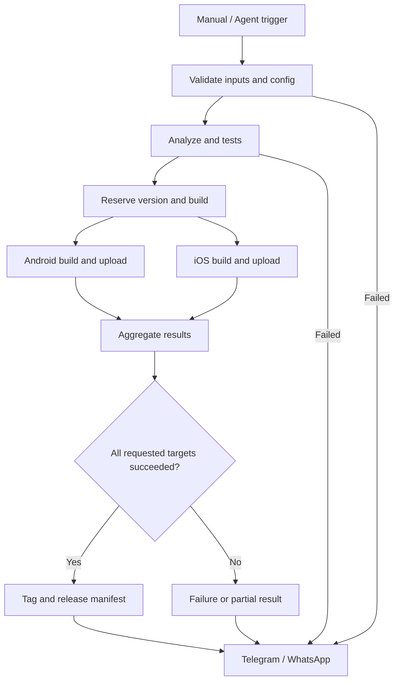

# Architecture والفلو

## فصل المسؤوليات

| المكان | المسؤولية |
|---|---|
| ريبو المحرك `YOUR_ORG/flutter-cicd` | reusable workflows، validation، version resolver، build/deploy adapters، notifications |
| ريبو التطبيق | Flutter code، flavors، entrypoints، config، caller workflow |
| GitHub Environments في ريبو التطبيق | dev/prod، secrets، صلاحيات الفروع والموافقة عند إعدادها |
| Firebase | التطبيقات، tester groups، توزيع النسخ |
| Agent | طلب workflow محدد ومتابعته، بدون التعامل مع مفاتيح التوقيع |

## تفاصيل التنفيذ

Checkout الافتراضي داخل reusable workflow يقرأ ريبو التطبيق caller، وليس ريبو المحرك. اعمل checkout إضافيًا للمحرك في مسار `_engine` عند نفس SHA المستخدم لاستدعاء workflow، وشغّل scripts منه. الريبو الخاص يحتاج تصريح قراءة منفصل للمحرك؛ تفعيل السماح باستخدام workflow لا يعني تلقائيًا أن GITHUB_TOKEN يستطيع checkout أي ريبو خاص.

Android على Linux، وiOS على macOS مع Xcode متوافق وsigning صحيح. احفظ artifacts بأسماء تتضمن environment/platform/version/build/run attempt لتجنب التصادم.

اجعل `fail-fast: false` عندما يكون المطلوب إكمال باقي المنصات بعد فشل واحدة. Notification job يستخدم `if: ${{ always() }}` ويجمع نتائج جميع jobs، حتى عند فشل validation. الإلغاء القسري أو تعطل runner قد يمنع هذا job؛ لا تعتبره ضمان توصيل مطلقًا.

أضف مفاتيح concurrency على مستوى ريبو التطبيق لمنع إصدارين متعارضين. رقم build يجب حجزه ذريًا قبل البناء وتوثيقه حتى إن فشل الإصدار. الإنشاء النهائي للـtag لا يتم إلا بعد نجاح كل أهداف التوزيع المطلوبة. في النجاح الجزئي سجل ما تم رفعه بالفعل ولا تدّع rollback تلقائيًا.
